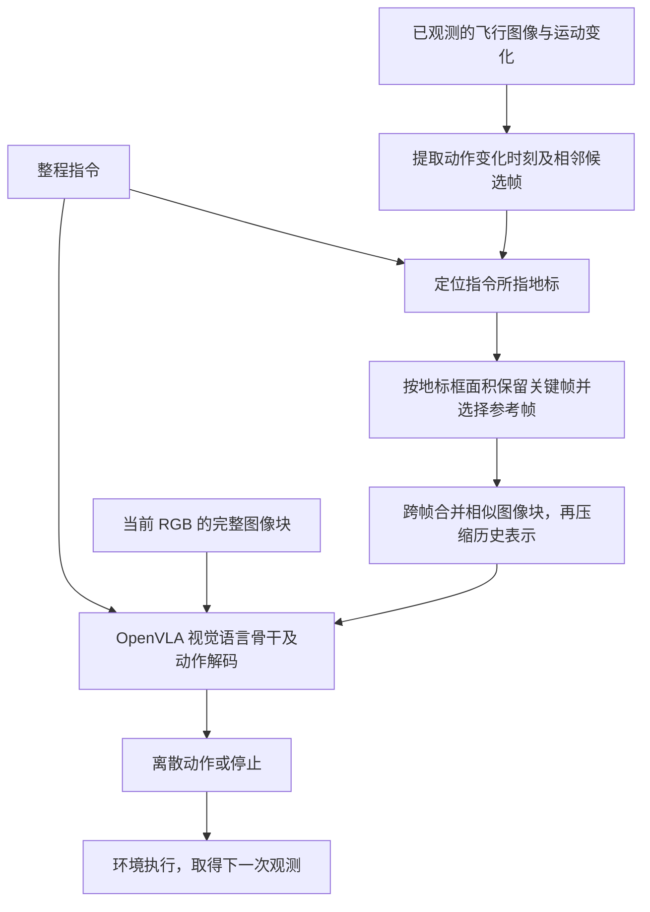
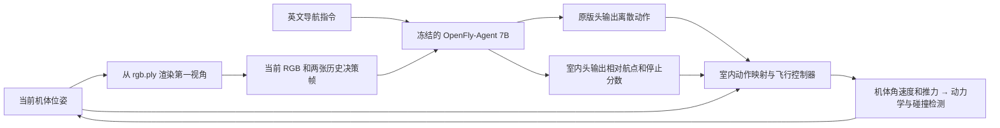

# OpenFly-Agent 算法与会议室 RGB 3DGS 导航流程

OpenFly 把空中视觉语言导航写成一个反复决策的问题。给定一条指令，飞机观察当前第一视角，结合已经见过的地标，决定下一步怎么飞、何时停止。Gao 等人的 OpenFly 平台提供训练示范，OpenFly-Agent 从这些示范中学习预测动作。本项目复用其公开 7B 权重，在会议室中保留了**原版离散动作基线**，并实现了**室内连续航点策略**。论文部分采用 ICLR 2026 正式发表的版本，对应 arXiv v7。[正式论文](https://openreview.net/pdf?id=OKm3w71ymP) · [原文图 4](https://arxiv.org/html/2502.18041v7#S5.F4)

## 一、原论文怎样构造导航任务

一条示范包含语言指令、沿途的机载图像和专家动作序列。可以把任务写成 `aₜ ~ π(· | 指令, 当前图像 Iₜ, 历史记忆 Hₜ)`。专家接下来采取的动作构成监督目标。部署时，由模型选择动作，环境执行并产生下一帧。因此某一步选错方向，会改变之后能看到的地标。这也是论文用闭环飞行评价模型的原因。[论文第 3 节](https://arxiv.org/html/2502.18041v7#S3) · [第 5 节](https://arxiv.org/html/2502.18041v7#S5)

| 离线环节 | 具体操作 | 交给下一环节的数据 |
|---|---|---|
| 场景和地标 | 从 Unreal Engine、GTA V、Google Earth 和 3DGS 场景采集观测，根据数据条件，用点云实例分割、投影轮廓或人工标注识别地标 | 可飞空间和具有语义的地标，如一栋特定建筑 |
| 专家轨迹 | 对可查询任意位姿的场景，将点云体素化，采样起点和地标附近的终点，按无人机动作空间执行 A* 搜索。多段路径可以首尾相接，再沿路径渲染第一视角 | 按时间对齐的位姿、RGB 和专家动作 |
| 语言指令 | 随前进、转向、升降等动作变化切分路径，把每段的动作和末尾三张图像交给视觉语言模型描述，再把各段描述合成一条指令 | 同时描述“怎样走”和“经过什么”的整程指令 |

作者据此构建了覆盖 18 个场景、约 10 万条轨迹的数据集。这里的 A* 用于**生成专家示范**。在线推理时，负责选动作的是 OpenFly-Agent。生成指令所用的“每段末尾三张图”也有单独的用途，模型飞行时的历史观测由下节的策略选取。[原文数据工具链](https://arxiv.org/html/2502.18041v7#S3.SS2) · [轨迹生成附录](https://arxiv.org/html/2502.18041v7#A5) · [指令生成附录](https://arxiv.org/html/2502.18041v7#A6)

## 二、原论文中 OpenFly-Agent 如何做一次决策



**1. 找出值得记住的画面。** 飞机在长直道上连续前进，相邻画面往往很像。从前进切换到转向时，指令中的地标可能刚刚出现。论文先以运动变化时刻为中心，取该帧及其前后各两帧组成候选集，再用三层交叉注意力融合语言模型隐状态中的文本和图像特征，预测指令所指地标的二维框。训练时用标注框和广义交并比（GIoU）损失学习定位。测试时按观测顺序预测各帧的框。框面积超过图像面积的 25% 是保留候选的条件。这个阈值衡量的是地标在视野中占多大。[原文 §5.1](https://arxiv.org/html/2502.18041v7#S5.SS1) · [§6.1](https://arxiv.org/html/2502.18041v7#S6.SS1)

**2. 压缩历史，保留当前空间细节。** 对同一组候选关键帧，取地标框最大的图像作参考，计算其图像块特征与组内其余帧的余弦相似度。把高相似度的块取平均合并，舍去比较帧中未合并的块。历史记忆按先进先出更新，实验取容量 `K=2`，并对历史表示做网格池化。当前帧保留全部 256 个图像块词元，以便模型判断地标此刻在左、在右或还有多远。公开推理实现的具体张量形状见下一节。[原文 §5.2](https://arxiv.org/html/2502.18041v7#S5.SS2) · [§6.1](https://arxiv.org/html/2502.18041v7#S6.SS1)

**3. 结合指令生成动作。** OpenFly-Agent 以 OpenVLA 为基础。经过视觉编码和投影后，图像词元与指令词元进入 Llama 2 7B。动作也用词元表示，动作编码占用词表末端的 256 个符号。训练阶段，用专家动作构造目标词元，刻画“看到这些图像并读到这条指令时，下一步选什么”。发布的训练代码在计算损失时屏蔽指令前缀，让模型根据视觉和指令预测专家动作词元。论文报告的训练批大小为 64，学习率为 `2×10⁻⁵`。[原文图 4 与第 5 节](https://arxiv.org/html/2502.18041v7#S5) · [训练配置](https://arxiv.org/html/2502.18041v7#S6.SS1) · [发布代码的训练样本转换](https://github.com/SHAILAB-IPEC/OpenFly-Platform/blob/c075075497a7122bad82f5b76b9be926ad5a81b3/train/datasets/dataset.py#L691-L734)

**4. 执行动作，再观察。** 论文定义六种语义动作，即前进、左转、右转、上升、下降和停止。生成轨迹时，前进步长可取 3、6 或 9 m，以适应不同的目标距离。执行一项动作后重新观察、更新视觉历史，再决定下一步。动作词表大小、动作类别数和执行距离是三个不同的量。论文表 3 比较了两种使用历史图像的方法。在已见场景测试中，均匀取历史帧并合并视觉词元的成功率为 16.6%，采用关键帧选择并合并词元后为 34.3%。这是论文的室外评测，成功判据包括在目标 20 m 内停止，碰撞计失败。[原文轨迹与动作分析](https://arxiv.org/html/2502.18041v7#S4.SS1) · [评测指标](https://arxiv.org/html/2502.18041v7#S6.SS2) · [消融表 3](https://arxiv.org/html/2502.18041v7#S6.T3)

## 三、公开权重在本项目中实际经过哪些模块

本项目固定使用 OpenFly-Platform 源码提交 `c0750754` 和 `IPEC-COMMUNITY/openfly-agent-7b` 权重版本 `21dcce23`。这里的“原版头”指**公开权重的动作词元预测与离散解码**。下表对照论文图 4，列出发布代码在推理时实际处理的图像和动作。[本地安装脚本](scripts/setup_openfly.sh) · [固定版本的权重配置](https://huggingface.co/IPEC-COMMUNITY/openfly-agent-7b/blob/21dcce235f1f2d40fc23c76998051abc5434cc99/config.json)

| 环节 | 公开评测和本地推理的实际行为 |
|---|---|
| 历史选帧 | 上游 `eval.py` 调用 `get_images(..., step=2)`，按时间取最近三次决策图像。本地用长度为 2 的队列保存过去的决策帧，加上当前图像。两条路径都直接按时间取帧，省略了论文中的运动变化检测和指令地标框筛选。[上游取帧函数](https://github.com/SHAILAB-IPEC/OpenFly-Platform/blob/c075075497a7122bad82f5b76b9be926ad5a81b3/train/eval.py#L387-L402) · [上游评测调用](https://github.com/SHAILAB-IPEC/OpenFly-Platform/blob/c075075497a7122bad82f5b76b9be926ad5a81b3/train/eval.py#L580-L601) |
| 视觉词元 | DINOv2 与 SigLIP 各自编码同一张 RGB。对于每张历史图，固定版本的前向实现拼接一个 DINOv2 前缀特征与池化后的 SigLIP 特征。对于当前图，按图像块拼接两条视觉支路的特征。经投影层后，语言模型接收 **1 个较早历史词元 + 1 个上一时刻词元 + 256 个当前词元 = 258 个视觉词元**。这一实现采用逐帧提取和池化，未在该前向路径中调用论文所述的跨帧余弦匹配。[上游视觉编码](https://github.com/SHAILAB-IPEC/OpenFly-Platform/blob/c075075497a7122bad82f5b76b9be926ad5a81b3/train/extern/hf/modeling_prismatic.py#L117-L145) · [视觉与文本嵌入的拼接](https://github.com/SHAILAB-IPEC/OpenFly-Platform/blob/c075075497a7122bad82f5b76b9be926ad5a81b3/train/extern/hf/modeling_prismatic.py#L388-L415) |
| 动作解码 | 公开推理按顺序生成 **8 个动作词元**，由词元 ID 查量化区间中心，再用 `vlnv1` 的各通道分位数还原为八维向量。四舍五入后匹配动作表。表内有 10 个 ID，含三个前进档和两个侧移 ID。默认统计中后四个通道的上下界都是零，因而当前基线实际只能匹配前进、左右转或停止等可达编码。本地将未匹配向量记录为 `invalid_model_action`，以便与主动停止分开统计。[上游反归一化](https://github.com/SHAILAB-IPEC/OpenFly-Platform/blob/c075075497a7122bad82f5b76b9be926ad5a81b3/train/extern/hf/modeling_prismatic.py#L524-L565) · [上游动作表](https://github.com/SHAILAB-IPEC/OpenFly-Platform/blob/c075075497a7122bad82f5b76b9be926ad5a81b3/train/eval.py#L404-L457) · [本地模型进程](openfly_rgb/model_worker.py) |

可以用会议室基线的第一条日志核对动作单位。模型输出约为 `[0.002, 0.018, 14.971, 0.029, 0, 0, 0, 0]`，取整后匹配 `action_id=2`，即左转。编码中的 `15` 参与动作识别。上游位姿执行器把该 ID 映射为左转 30°，本项目的室内映射则给出左转 15° 的跟踪目标，之后还要经过动力学才能得到实际转角。[原版头决策日志](outputs/openfly_room65_rgb_baseline/decisions.jsonl) · [上游位姿更新](https://github.com/SHAILAB-IPEC/OpenFly-Platform/blob/c075075497a7122bad82f5b76b9be926ad5a81b3/train/eval.py#L464-L498) · [室内动作映射](openfly_rgb/flight.py)

## 四、会议室里的 RGB 导航闭环

当前任务是让无人机“沿会议桌向门侧前进，绕过桌端，转向挂壁空调并悬停”。模型进程实际收到的默认指令如下。

> Fly along the side of the conference table toward the door. Go around the end of the table, then turn to face the wall-mounted air conditioner and hover.

传入 `--room-head` 后，模型做一次视觉语言前向计算，室内头直接从隐藏特征产生航点。省略该参数时，模型调用 `predict_action()` 生成离散动作。两个分支共享同一第一视角、碰撞模型和动力学，室内头可以独立决定向哪个方向移动和何时停下。[推理分支](openfly_rgb/model_worker.py) · [指令及运行入口](openfly_rgb/navigate.py)



模型在每次决策时只接收指令和图像。控制器另行读取当前位姿、速度和姿态，将模型输出变成可执行的控制量。示范位姿用于离线制备标签，终点坐标用于飞行结束后的评分。当前版本采用示范监督拟合航点头，GRaD-Nav 动力学负责在线飞行。红外分支和可微强化学习属于后续研究范围。[导航主循环](openfly_rgb/navigate.py) · [飞行控制接口](openfly_rgb/flight.py)

### 如何用离线示范拟合室内航点头

**已有 `room65_rgb.npz` 时可以直接飞行。** 只有需要重新生成这个航点头时，才运行拟合流程。

1. **从模拟器的专家飞行取样。** `route.json` 中的航点标出开始运动和末段悬停的时间，`flight/frames.jsonl` 提供控制器跟踪这条路线时，动力学实际产生的机体位姿。拟合程序在第 1 至 24 秒逐秒取样，共 24 个时刻，包含末段的两个悬停观测。[参考路线](scenes/room65_selected_anchored/route.json) · [专家飞行记录](scenes/room65_selected_anchored/flight/frames.jsonl)
2. **用当前 RGB 模型重渲染。** 渲染器读取会议室的 `models/rgb.ply`，使用已标定的相机内参和机载相机安装位姿。在原视角和 11 组平移、偏航或机身调平的变体上重渲染，得到 **24 × 12 = 288** 组观测。每组视角变体从空历史开始，随后按时间顺序送帧。这样，旧示范提供运动轨迹，模型看到的画面来自当前 PlanarGS 场景。[样本与扰动生成](openfly_rgb/fit_room.py) · [场景标定与资产来源](scenes/room65_selected_anchored/README.md)
3. **生成室内动作标签。** 对当前观测位姿，取专家 **1 秒后**的世界坐标，减去渲染该观测时的机体位置，再按当前偏航旋转到水平机体系。所得标签为 `[向前 m, 向左 m, 向上 m, 相对偏航 °, STOP]`。扰动样本仍指向原示范的未来位置，因此包含回到路线所需的修正量。只有到达示范的末段，且位置差 ≤0.18 m、偏航差 ≤15° 时，才标记停止。本次 288 个样本中有 20 个停止标签。[拟合记录](outputs/openfly_room65_fit/room65_rgb.fit.json)
4. **从 OpenFly 特征拟合输出。** 冻结的 7B 模型用 DINOv2 和 SigLIP 编码 RGB，并让指令与视觉历史共同参与前向计算。当前 v2 航点头取最后一个指令词元的 4096 维融合表示，同时将当前图像的 16×16 个图像块汇集到 4×4 个区域，每区用固定的随机投影压到 96 维。两部分拼接得到 **5632 维**输入。程序据此拟合带正则化的径向基函数回归，在线预测时还结合特征最相近的四个训练样本的动作标签。航点头文件保存回归参数、样本特征和对应标签。[特征提取与回归实现](openfly_rgb/model_worker.py) · [已拟合的航点头](outputs/openfly_room65_fit/room65_rgb.npz)

### 在线飞行如何从一张图走到下一张图

**初始化。** 默认从模拟器世界坐标 `[-1.55, 1.10, 1.41] m`、偏航 `−16°` 起飞。飞行入口加载 `scenes/room65_selected_anchored/models/rgb.ply`（PlanarGS 30k），通过 `RigScene(..., render_thermal=False)` 仅渲染 RGB。相机随机体刚性运动，场景标定负责在重建坐标和米制世界坐标间转换。碰撞表面与自由空间来自对齐的 RGB 24k 资产，室内尺度以假定的 2.80 m 层高锚定。[房间资产与坐标说明](scenes/room65_selected_anchored/README.md) · [标定相机](scenes/room65_selected_anchored/room.py) · [飞行初始化](openfly_rgb/flight.py)

主进程启动室内模拟器和独立的 OpenFly 推理进程。模拟器从当前机体位姿渲染 RGB，主进程把最新图像编码成 PNG，连同指令发送给模型。模型从旧到新排列三帧。第一次决策使用 `[首帧, 首帧, 首帧]`，第二次是 `[首帧, 首帧, 当前帧]`，此后保留最近两次决策帧。这里的历史间隔是**两次模型决策之间的飞行时间**。在已验证的配置中，模拟器渲染 320×240 RGB，模型处理器再转换为 224×224 输入。[进程通信](openfly_rgb/navigate.py) · [图像历史和推理](openfly_rgb/model_worker.py)

| 环节 | 室内航点头（传入 `--room-head`） | 原版离散动作头（省略 `--room-head`） |
|---|---|---|
| 模型输出 | 连续的前、左、上位移，相对偏航，以及停止分数 | 生成 8 个动作词元，反归一化为八维向量，四舍五入后与上游动作表匹配 |
| 室内动作 | 可以在同一段运动中同时侧移和转向。单次水平位移模长最多 0.70 m，上下最多 0.30 m，偏航最多 35° | 三个前进档对应 0.15、0.30、0.45 m，左右转对应 ±15° |
| 结束决策 | `stop_score >= 0.5` 触发制动悬停 | 匹配到 `STOP` 才触发制动悬停。无法匹配的向量单独记为 `invalid_model_action` |

**如何把相对航点飞出来。** 设当前位置为 `p`，偏航为 `ψ`。飞行接口将预测的前、左、上位移绕世界竖轴旋转到当前航向，得到 `p_goal = p + Rz(ψ) · [Δ前, Δ左, Δ上]`，目标偏航为 `ψ + Δ偏航`。控制器按五次多项式插值得到参考位置、速度和加速度，再根据实际位置与速度的误差、当前姿态和重力补偿计算角速度与推力。模拟器据此更新机体和相机位姿，再渲染下一帧。[坐标变换与航点执行](openfly_rgb/flight.py) · [轨迹插值和控制器](scenes/room65_selected_anchored/fly.py)

每 **0.05 秒**控制器更新一次 `[ωx, ωy, ωz, 推力比例]`，调用 `sim.step(..., format="body_rates_thrust")`。每个完整控制步包含 10 个 0.005 秒动力学子步。模拟器用 `collision/rgb_surface_m.ply` 检查机身扫掠碰撞，飞行接口用 `collision/free_volume.npz` 检查机身是否处于已观测空域。碰撞、离开已知自由空间或达到步数上限都会结束回合，结束原因写入 `summary.json`。[动力学执行与碰撞回执](engine.py) · [室内终止条件](openfly_rgb/flight.py)

**标签的 1 秒和执行的 2 秒有不同含义。** 航点表示专家在 1 秒内到达的位置。无人机实际用 1.5 秒跟踪该航点，再保持 0.5 秒稳定姿态，随后从实际到达的位置渲染下一张决策图像。收到停止指令时，控制器在当前位置保持 1.5 秒。末速度 ≤0.06 m/s 且漂移 ≤0.08 m 才记为 `policy_stop`。[航点执行与悬停判断](openfly_rgb/flight.py)

### 用一次模拟器闭环飞行对照日志

以下记录来自**示范起点、室内航点头**的同一次飞行。用 `decisions.jsonl` 的 `observed_frame` 对齐 `frames.jsonl` 的 `frame_id`，就能找到模型作出决策时的画面和状态。

| 仿真时刻 | 记录 | 含义 |
|---|---|---|
| 0.0 s，第 0 帧 | 第 1 次决策输出 `[0.182, 0.071, 0.010, -0.024]`，`stop=false` | 相对当时的机头，前进约 18.2 cm、向左约 7.1 cm，并略微上升。最后一项为偏航角，单位是度 |
| 2.0 s，第 40 帧 | 第 2 次决策开始，机体世界位置约为 `[-1.354, 1.118, 1.419] m` | 第一次航点已执行了 40 个控制步，这一帧成为新的视觉输入 |
| 20.0 s，第 400 帧 | 第 11 次决策输出 `[-0.066, -0.465, -0.022, +24.650]` | 无人机绕过桌端时，略后退、右移约 46.5 cm、下降约 2.2 cm，同时向左转约 24.65° |
| 40.0 s，第 800 帧 | 第 21 次决策给出 `stop_score=1.0` | 控制器继续制动保持，直至 41.5 s、第 830 帧确认悬停。含初始帧，录像共 831 帧 |

在 `decisions.jsonl` 中看模型选择，在 `frames.jsonl` 中看实际位姿、控制量与碰撞，在 `summary.json` 中看结束原因和评分。`rgb_fpv.mp4` 是相同帧序的第一视角录像。原版头的 `decisions.jsonl.raw_action` 表示模型的八维输出，逐帧日志的 `frames.jsonl.raw_action` 则表示送往动力学的四维控制命令。[决策记录](outputs/openfly_room65_rgb_nominal/decisions.jsonl) · [逐帧回执](outputs/openfly_room65_rgb_nominal/frames.jsonl) · [对应录像](outputs/openfly_room65_rgb_nominal/rgb_fpv.mp4)

## 五、怎样判定室内任务完成

`evaluation.success` 要求模型主动停止并稳定悬停，终点距离误差 ≤0.30 m，末速度 ≤0.10 m/s。指定目标朝向时，偏航误差还须 ≤20°。默认路线目标为 `[0.50, -0.83, 1.45] m`、偏航 `95°`。自定义指令可以用 `--goal` 和 `--goal-yaw` 指定评分目标，省略目标位置时 `success` 为 `null`。

`route_check` 单独检查默认绕桌指令的过程。程序沿参考轨迹和实飞轨迹按不超过 5 cm 的间隔采样，在 0.35 m 容差内计算两者的覆盖比例，并检查无人机是否**按顺序**经过桌端的两个检查点。例如原版头一直在参考起点转向，所以它的实飞路径贴合度为 100%，参考路线覆盖率却只有 6.84%，两个桌角都未经过。[评分实现](openfly_rgb/navigate.py)

| 已保存的 320×240 RGB 飞行 | 决策数 | 按序经过桌角 | 终点误差 | 结束原因 |
|---|---:|---:|---:|---|
| [原版头，示范起点](outputs/openfly_room65_rgb_baseline/summary.json) | 40 | 0/2 | 2.816 m | `max_steps`，原地转向，平移 0 m |
| [室内头，示范起点](outputs/openfly_room65_rgb_nominal/summary.json) | 21 | 2/2 | 0.207 m | `policy_stop`，朝向误差 3.73° |
| [室内头，偏移起点](outputs/openfly_room65_rgb_offset/summary.json) | 22 | 2/2 | 0.258 m | `policy_stop`，朝向误差 5.63° |

两次室内头飞行均无碰撞。偏移起点相对示范起点平移约 0.19 m，航向改变 10°。上述结果验证了同一会议室、同一条指令在这两个起点的闭环执行。新指令、新目标和新房间的泛化仍待评估。[俯视轨迹对比](outputs/openfly_room65_fit/trajectory_comparison.png)

## 六、复现入口

在已配置的模拟器环境中运行下列命令。首次在新机器上运行时，先在激活环境后执行一次 `bash scripts/setup_openfly.sh`，安装固定版本的推理代码并下载官方权重。两条导航命令各自启动一次飞行，第一条使用室内航点头，第二条使用原版离散头。两者均使用 GPU 渲染和默认的四位量化模型推理。[安装脚本](scripts/setup_openfly.sh)

```bash
cd /home/zr_fan/3DGS_env/gs_gradnav_simulator
conda activate thermal_gaussian_5070

python -B -m openfly_rgb.navigate --resolution .5 --device cuda:0 \
  --room-head outputs/openfly_room65_fit/room65_rgb.npz
python -B -m openfly_rgb.navigate --resolution .5 --device cuda:0
```

每次飞行默认写入新的 `outputs/openfly_rgb_<时间戳>/`。先查看该目录的 `summary.json` 中的 `outcome`、`evaluation.success` 和 `route_check`，再播放 `rgb_fpv.mp4` 对照实际路线。若要复现上表的偏移起点，在室内头命令末尾加 `--spawn -1.40 1.22 1.41 --yaw -6`。

若需重新拟合，在同一环境中执行下列命令并选择新的输出名。拟合和导航分开运行，每次加载一份 7B 模型。默认缓存目录为 `~/.cache/openfly-room65/`，其中包含上游源码、官方权重和模型进程的独立 Python 环境。新机器的安装步骤和查看器用法见 [项目 README](README.md)。

```bash
python -B -m openfly_rgb.fit_room --resolution .5 --device cuda:0 \
  --output outputs/openfly_room65_fit/retrained.npz
```
