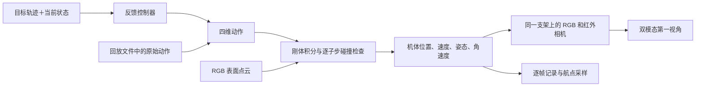

# 无人机模拟器原理与状态字段

以「会议室 6＋5 · RGB 表面锚定」场景为例。模拟器用刚体动力学计算无人机飞到哪里，用 RGB 和红外两套 3D 高斯模型生成此刻看到的画面，用经过多视角验证的 RGB 表面点云判断能否通过。读飞行数据时，用同一帧号对齐输入的动作、执行后的机体状态，以及从该状态渲染的相机图像。[场景说明](scenes/room65_selected_anchored/README.md)

## 1. 一个动作怎样变成一帧飞行

**录制巡航时**，控制器先在计划的路径节点之间平滑插值，得到目标位置、速度、加速度和航向。它比较目标与当前状态，算出所需推力方向及姿态，再输出四个控制量。**回放时**，查看器从文件首帧恢复初始位置和航向，此后逐行取原始动作，重新运行同一套动力学。支架俯仰也按记录恢复。航点文件负责在场景里显示离散轨迹，加载航点不会移动无人机。[巡航控制器](scenes/room65_selected_anchored/fly.py) · [动作回放](scenes/room65_selected_anchored/action_replay.py)

| 环节 | 在当前场景中怎样工作 |
|---|---|
| 动作输入 | 巡航使用 `body_rates_thrust = [ωx_cmd, ωy_cmd, ωz_cmd, c]`。前三项是机体系目标角速度，单位 rad/s；第四项是总推力占最大推力的比例，范围 0～1。此格式直接进入角速度控制，推力比例会限幅。引擎也支持归一化策略动作，其缩放、低通和延迟走另一条输入路径。 |
| 姿态更新 | 每个子步根据目标与实际角速度之差、角加速度估计计算控制力矩；用机体惯量和陀螺项求角加速度，先更新实际角速度，再积分并归一化姿态四元数。 |
| 平移更新 | 总推力沿**机体 +Z** 方向。当前姿态将它转到世界系，再合入向下的重力及与速度反向的二次阻力。先更新速度，再用新速度更新位置。因此，机体倾斜时，总推力的一部分会产生水平加速度。 |
| 时间推进 | 每个动作通常持续 **0.05 s（20 Hz）**，内部积分 **10 个 0.005 s 子步（200 Hz）**。每个子步都检查机身扫过的空间。正常完成一个动作后发布一帧；发生接触时发布精确到子步内的停止状态。 |

当前会议室采用 `nominal` 配置，质量 **1.1 kg**，最大总推力 **26 N**，重力加速度 **9.81 m/s²**，质量、惯量和控制噪声均固定。水平静止时，直接控制格式的悬停输入约为 `[0, 0, 0, 0.41504]`，因为 `1.1 × 9.81 / 26 ≈ 0.41504`。若使用 `gradnav_normalized`，第四维按 `0.25 × (a₄ + 1)` 换算，相同的稳态悬停对应约 **0.66015**。[动力学](dynamics.py) · [动作适配器](action_adapter.py) · [名义配置](configs/nominal.json)

## 2. 无人机的状态包含哪些参数

**动力学直接积分 13 个数**，顺序固定为 `[x, y, z, vx, vy, vz, qw, qx, qy, qz, ωx, ωy, ωz]`。这是六自由度刚体的位置、姿态及其速度。姿态用四个受单位长度约束的数表示。另有四个派生字段随每帧的 `state` 一起发布，便于直接读取速度大小、欧拉角和加速度。[状态初始化](dynamics.py) · [逐帧字段定义](engine.py)

| `state` 字段 | 排列 / 单位 | 坐标系与含义 |
|---|---|---|
| `position` | `[x, y, z]`，m | 世界系中的机体中心。世界 +Z 向上。查看器的“飞行高度”直接显示 z，若飞到桌面上方，该数仍以场景原点为基准。 |
| `velocity` | `[vx, vy, vz]`，m/s | 世界系线速度。正 vz 表示爬升。沿机头方向的速度可由 `R(q)ᵀ · velocity` 的第一分量取得。 |
| `quaternion_wxyz` | `[qw, qx, qy, qz]`，无量纲 | 从**机体系转到世界系**的单位四元数，实部排在最前。机体 +X 向前、+Y 向左、+Z 向上；`q` 和 `−q` 表示同一姿态。 |
| `angular_velocity` | `[ωx, ωy, ωz]`，rad/s | **机体系**实际角速度，按右手定则分别绕机体 X、Y、Z 轴。动作文件里的目标角速度与这里的量可以不同。 |
| `linear_acceleration` | `[ax, ay, az]`，m/s² | 最近一个积分子步的世界系合加速度，已包含重力。理想静止悬停时接近零；要模拟机载加速度计，还需扣除世界重力再转到机体系。 |
| `angular_acceleration` | `[αx, αy, αz]`，rad/s² | 最近一个积分子步的机体系角加速度。 |
| `euler_deg` | `[roll, pitch, yaw]`，度 | 从四元数按 SciPy 的 `as_euler('xyz', degrees=True)` 分解，便于阅读。机体水平且 yaw 为 0° 时，机头指向世界 +X；yaw 为 +90° 时指向世界 +Y。 |
| `speed` | 标量，m/s | 世界系线速度的三维模长 `√(vx² + vy² + vz²)`，包括升降分量。 |

### 读一帧实际记录

在“沙发多角度横移”第 **120 帧**，仿真时间为 **6.00 s**。机体中心约为 `(−0.987, 0.616, 1.531) m`，世界系速度约为 `(0.297, −0.033, 0.014) m/s`，合速度为 **0.299 m/s**。此时机体俯仰约 **+0.044°**，共用相机支架相对基础安装姿态的俯仰为 **−30.215°**。所以无人机可以近乎水平地横移，同时保持低头观察沙发。该帧也是 `waypoint_id=20`，可以直接用 `frame_id=120` 对齐动作、相机和航点。[逐帧记录](scenes/room65_selected_anchored/runs/20261119_sofa_views/01_sofa_arc/frames.jsonl) · [航点 CSV](scenes/room65_selected_anchored/runs/20261119_sofa_views/01_sofa_arc/waypoints.csv)

## 3. 怎样从机体状态得到 RGB 和红外画面

RGB 基础相机中心相对机体中心的安装偏移是 `[0.152, 0.031, 0.012] m`，沿机体前、左、上三个方向计量。每帧的相机中心为 `p_body + R(q) · offset`。随后整套支架绕 RGB 相机局部横轴俯仰，再使用标定好的 RGB 到红外刚性变换得到红外相机。两路传感器同步运动，但各有自己的光心和内参。[基础相机安装](cameras.py) · [场景双模态渲染](scenes/room65_selected_anchored/room.py)

每个传感器用自己的相机矩阵，把对应 3D 高斯投影到图像平面，并按深度和不透明度合成颜色。会议室录像的两路分辨率都是 **640 × 480**；RGB 焦距约 **499.5 px**，红外约 **954.7 px**，所以红外画面覆盖的角度更窄。红外输出沿用重建数据的伪彩外观；逐像素温度需要单独的辐射定标。[该段相机内参与外参](scenes/room65_selected_anchored/runs/20261119_sofa_views/01_sofa_arc/calibration.json)

| 字段 | 读法 |
|---|---|
| `rig_pitch_deg` / `rgb_optical_elevation_deg` | 前者是支架相对基础安装姿态的俯仰；后者是 RGB 光轴相对世界水平面的实际仰角。 |
| `rgb_c2w_sim_m` / `thermal_c2w_sim_m` | 4×4 齐次矩阵，把光学相机坐标变换到仿真世界，平移单位为米。光学相机轴为右、下、前；前三行最后一列给出相机中心。 |
| `rgb_w2c_native` / `thermal_w2c_native` | 从原始重建世界到相应光学相机，平移使用重建单位。对列向量，`W_thermal = T_rgb_to_thermal · W_rgb`。用这组矩阵投影仿真航点前，要先转换世界坐标与尺度。 |

会议室采用 `p_sim = s · R · (p_native − origin)`，其中 `s ≈ 0.492903` 米/重建单位。这个比例以假定的 **2.80 m 层高**建立，尚无现场标尺复核。因此文中的距离、净空及碰撞位置均按仿真尺度解释。[场景坐标变换](scenes/room65_selected_anchored/inputs/frame.json)

## 4. 什么时候算碰撞

机体是随姿态旋转的 **0.60 × 0.60 × 0.12 m** 长方体，六面各留 **0.05 m** 安全余量。模拟器每个子步用外扩后的 **0.70 × 0.70 × 0.22 m** 长方体检查从旧姿态到新姿态的扫掠。首次触及障碍时，机体停在接触前的微小退让位置，线速度和角速度清零，结束该次飞行。这种终止方式适合导航碰撞判定；终止帧的加速度清零，无法据此估算碰撞冲量。[碰撞检测](pointcloud.py) · [终止处理](engine.py)

会议室的碰撞表面由 **478 个 RGB 训练视角**生成。建图时融合 RGB 渲染深度、与 SfM 对齐的预测深度及已验证的局部平面，在 **4 cm** 体素内汇总；候选表面至少要得到 **3 个彼此相隔 22 cm 或以上的机位**支持，并通过自由空间反证和邻域筛选。最终保留 **34,686 个表面点**。这能减轻空中漂浮高斯引起的误碰；细线和缺测表面仍可能漏检。巡航录制时还用独立的 **10 cm** 已观测空域网格检查飞行包络。[建图实现](scenes/room65_selected_anchored/prepare.py) · [建图统计](scenes/room65_selected_anchored/collision/build.json)

| 回执字段 | 含义 |
|---|---|
| `collision.clearance` / `collision.safety_clearance` | 分别为点云到机体盒、到安全盒的最小有符号距离，单位 m。正值表示分离，零表示接触，负值表示有点落在盒内。查看器显示后者。 |
| `min_sampled_safety_clearance` | 该动作执行期间，在子步采样位置取得的最小安全净空。连续扫掠另行判断运动途中是否接触。 |
| `collision.event` | 首次接触事件。`point` 为障碍表面点，`position` 为停止时的机体中心，`time` 为事件仿真时刻。终止后的退让可使 `in_collision` 为假，应按事件判读是否撞过。 |
| `terminated` / `truncated` / `reason` | 碰撞、失效或超出飞行限制会终止回合；达到步数上限会截断回合。查看器也会在动作文件用尽时显示“已完成”。 |

例如沙发左侧接触发生在 **12.645954 s**，最后一条动作只执行 **0.045954 s**。表面点约为 `(−1.002, 2.810, 0.814) m`，机体中心约为 `(−1.230, 2.459, 0.910) m`。此时 `reason="collision"`、`speed=0`，并且 `collision.in_collision=false`。这三个值可以同时成立。[接触事件](scenes/room65_selected_anchored/runs/20261119_sofa_views/03_sofa_left_contact/contact.json) · [逐帧数据](scenes/room65_selected_anchored/runs/20261119_sofa_views/03_sofa_left_contact/frames.jsonl)

## 5. 如何对齐动作、状态、航点和策略观测

- **动作与时间。** 每次飞行有独立的 `episode_id`。第 0 帧是初始状态，`raw_action=null`。从下一帧起，`raw_action` 是产生该帧的原始指令，`applied_control` 是送入动力学的控制量，`sim_time` 是累计仿真时间，`dt_actual` 是本次实际推进时长。`step_id` 在回合重置时归零。引擎的 `frame_id` 在同一实例上跨重置递增；会议室的单段录制使用新实例，文件中的视频帧号从 0 开始。[步进引擎](engine.py) · [回放服务](scenes/room65_selected_anchored/replay_viewer.py)
- **航点与标注。** 会议室每 **0.30 s** 从实际状态采样一个航点，即从第 0 帧起每 6 个完整控制步采一次。`waypoints.csv` 保存序号、时刻、帧号、位置、四元数、速度和支架俯仰。碰撞终点可能落在两次采样之间，准确终点见 `contact.json`。[巡航记录器](scenes/room65_selected_anchored/record_survey_contacts.py)
- **策略观测。** 动力学真值用于推进和核验；策略使用引擎另外构造的观测。默认布局前 **17 维**依次为高度、垂直速度、四元数 **xyzw**、当前及上一步的实际控制量各 4 维、世界系线速度 3 维。配置相应编码器后，可再加入 16 维 RGB 视觉特征和 24 维上下文，得到 **57 维**。当前会议室回放未加载这些策略资产，`policy_ready=false`。外部多模态导航程序可以从同帧 RGB、红外和所需状态自行构造输入；现有 57 维布局没有单独的红外特征槽位。[观测定义](observations.py) · [会议室回放配置](scenes/room65_selected_anchored/action_replay.py)

已完成的桌面巡航复刻给出了端到端对照。使用相同初始位姿、名义动力学、种子 65、原始动作及支架俯仰，重放 **1,599 条动作**后得到 **1,600 帧、79.95 s** 的飞行。逐帧比较的位置、速度、姿态及两路相机矩阵，以及 **267 个航点**的位置，在该次验证中最大差值均为零。[复刻核验数据](scenes/room65_selected_anchored/runs/20261119_sofa_views/05_original_actions_replay/verification.json)

